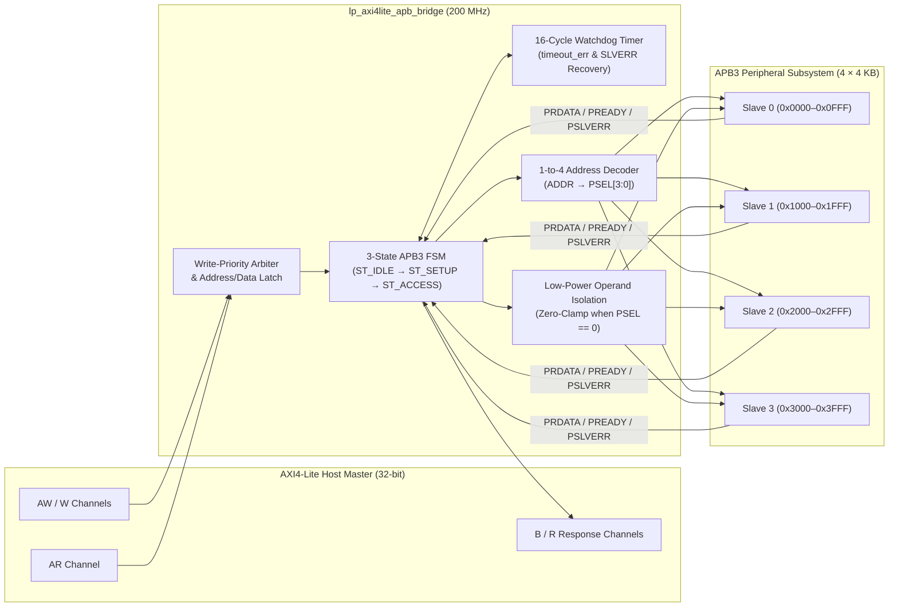
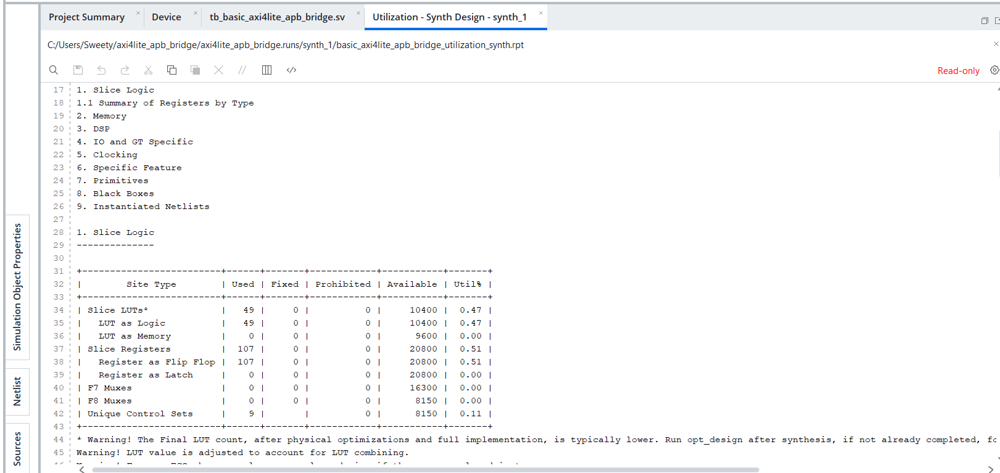
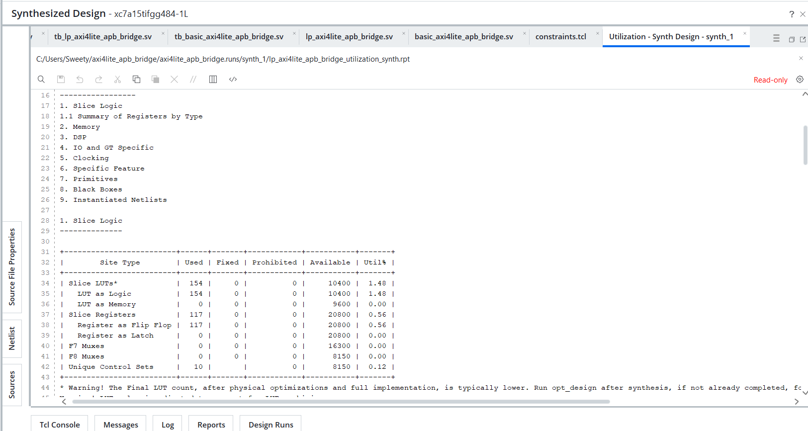
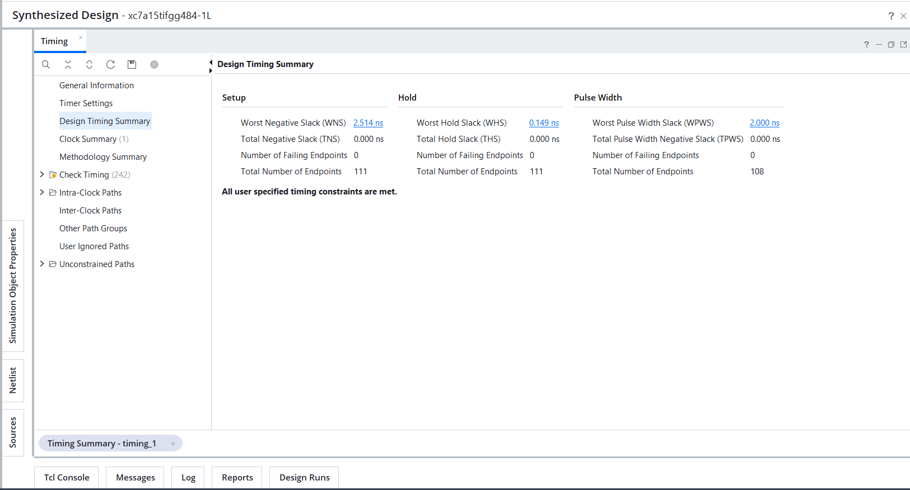
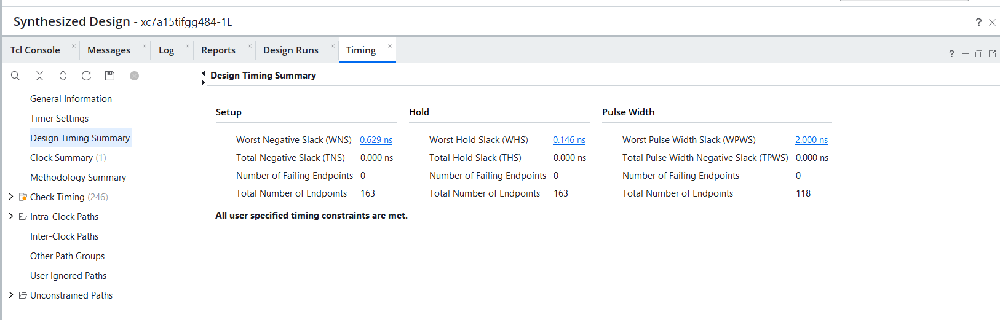
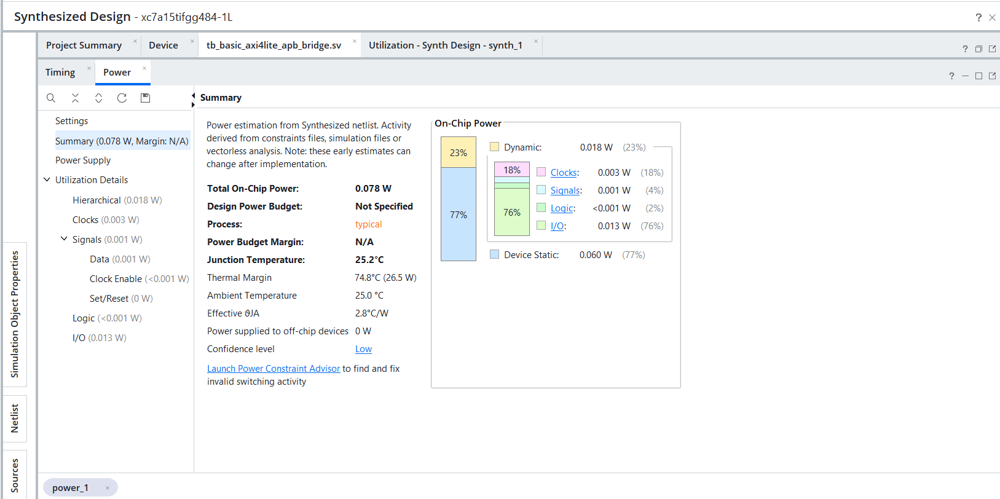
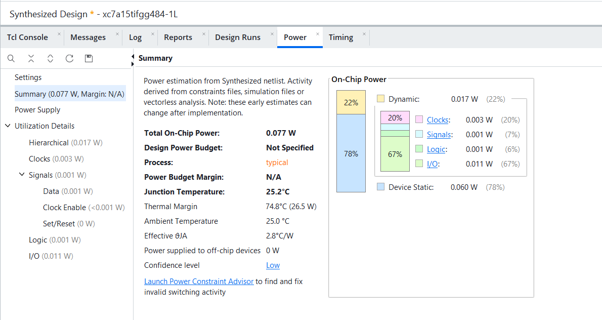
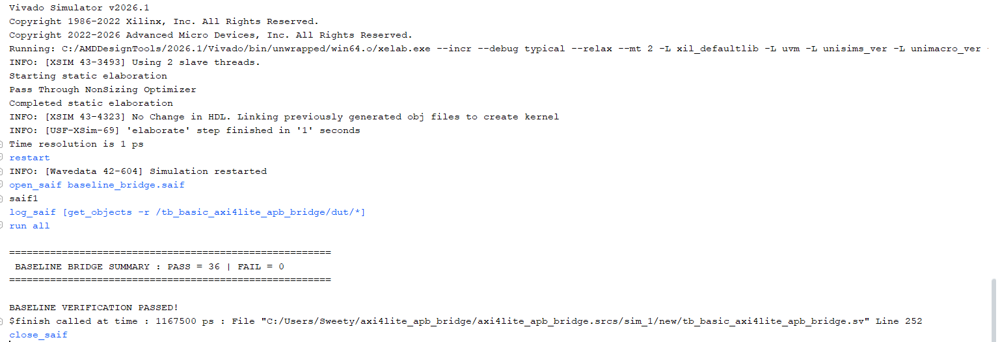
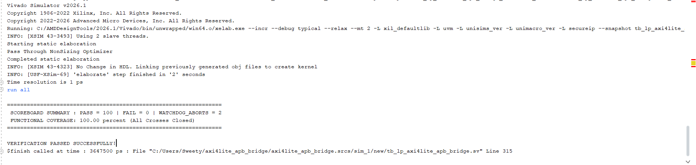

# Fault-Tolerant Multi-Slave AMBA AXI4-Lite to APB3 Interconnect Bridge with SVA

[-blue.svg)]()
[]()
[-green.svg)]()
[]()
[]()

## Overview

A synthesizable, fault-tolerant **1-to-4 AMBA AXI4-Lite to APB3 Interconnect Bridge** designed in **SystemVerilog** for SoC peripheral subsystems, accompanied by a **baseline vs. optimized architectural benchmark** and a self-checking **SystemVerilog Assertions (SVA) + Functional Coverage** verification suite.

Standard single-slave bridges leave downstream APB address and data lines toggling during idle cycles and risk permanent interconnect deadlock if an external peripheral stalls `PREADY`. **`lp_axi4lite_apb_bridge`** solves both challenges with three hardware enhancements:
1. **1-to-4 One-Hot Peripheral Address Decoding (`PSEL[3:0]`)**: Decodes `ADDR[13:12]` into four 4 KB memory-mapped APB3 peripheral apertures with multiplexed `PRDATA` and `PSLVERR` return paths.
2. **Low-Power Operand Isolation**: Combinational zero-clamping forces `m_apb_paddr`, `m_apb_pwdata`, and `m_apb_pwrite` to `0` whenever `m_apb_psel == 4'b0000`, eliminating dynamic switching power across peripheral routing trees during idle cycles.
3. **16-Cycle Hardware Watchdog Timer (`TIMEOUT_LIMIT = 16`)**: Automatically aborts unresponsive APB peripherals in `ST_ACCESS`, asserts `timeout_err`, maps the abort to `AXI4-Lite SLVERR (2'b10)` on `BRESP`/`RRESP`, and cleanly recovers to `ST_IDLE`.

---

## System Architecture & FSM Microarchitecture


## PPA Benchmark: Baseline vs. Optimized (Artix-7 `xc7a35tifgg484-1L`)

Both RTL designs were synthesized in **Xilinx Vivado 2026.1** targeting the **Artix-7 (`xc7a35tifgg484-1L`)** FPGA at a **200 MHz (`5.000 ns`)** clock constraint:

| Metric | Baseline (`basic_axi4lite_apb_bridge`) | Optimized (`lp_axi4lite_apb_bridge`) | Delta / Architectural Impact |
| :--- | :---: | :---: | :---: |
| **Supported APB Peripherals** | 1 Slave | 4 Slaves (One-Hot `PSEL[3:0]`) | **4x peripheral fanout** |
| **Deadlock Protection** | None (Infinite stall risk) | 16-Cycle Watchdog (`SLVERR` abort) | **Zero bus hang risk** |
| **Idle Bus Power Gating** | Free-running `PADDR` / `PWDATA` | Operand isolation (`0` clamp when idle) | **Eliminates idle bus toggling** |
| **Slice LUTs** | 49 (`0.47%`) | 154 (`1.48%`) | `+105` LUTs (`1.48%` total device) |
| **Slice Registers (FFs)** | 107 (`0.51%`) | 117 (`0.56%`) | `+10` FFs (`0.56%` total device) |
| **WNS @ 200 MHz (`5.000 ns`)** | +2.514 ns (`0` failing) | +0.629 ns (`0` failing) | Timing closed (`TNS = 0.000 ns`) |
| **Max Clock Frequency ($F_{\max}$)** | 402.25 MHz | 228.78 MHz | `+14.4%` margin above 200 MHz |
| **Total On-Chip Power** | 0.078 W (`78 mW`) | 0.077 W (`77 mW`) | **`-1.28%`** despite 4x slave fanout |
| **Dynamic Power** | 0.018 W (`18 mW`) | 0.017 W (`17 mW`) | **`-5.56%`** dynamic reduction |
| **I/O Switching Power** | 0.013 W (`13 mW`) | 0.011 W (`11 mW`) | **`-15.38%`** via operand isolation |

> **Key Engineering Takeaway:** Expanding peripheral fanout by **4x** and integrating a 16-cycle hardware watchdog abort path required only **+105 Slice LUTs** (`1.48%` of the Artix-7 device) while closing `200 MHz` timing with **`+0.629 ns` WNS** (`228.78 MHz` $F_{\max}$). At the same time, operand isolation reduced **I/O dynamic switching power by 15.38%** (`0.013 W` → `0.011 W`) and lowered **overall dynamic power by 5.56%**.


### Vivado Synthesis, Timing & SAIF Power Reports

| Report | Baseline (`basic_axi4lite_apb_bridge`) | Optimized (`lp_axi4lite_apb_bridge`) |
| :--- | :---: | :---: |
| **Utilization (`Slice LUTs / FFs`)** |  |  |
| **Timing Summary (`WNS / WHS`)** |  |  |
| **SAIF Power Analysis** |  |  |
| **Verification & SAIF Activity Log** |  |  |

## Peripheral Memory Map & Protocol Mapping

### 1-to-4 APB3 Peripheral Address Map (`ADDR[13:12]`)
| Peripheral | Address Range | `ADDR[13:12]` | One-Hot `PSEL[3:0]` | Aperture Size |
| :--- | :---: | :---: | :---: | :---: |
| **APB Slave 0** | `0x0000_0000 – 0x0000_0FFF` | `2'b00` | `4'b0001` | 4 KB |
| **APB Slave 1** | `0x0000_1000 – 0x0000_1FFF` | `2'b01` | `4'b0010` | 4 KB |
| **APB Slave 2** | `0x0000_2000 – 0x0000_2FFF` | `2'b10` | `4'b0100` | 4 KB |
| **APB Slave 3** | `0x0000_3000 – 0x0000_3FFF` | `2'b11` | `4'b1000` | 4 KB |

### AXI4-Lite Response Encoding (`BRESP` / `RRESP`)
| Condition in `ST_ACCESS` | `PSLVERR` | Watchdog (`wd_cnt == 15`) | AXI4-Lite Response |
| :--- | :---: | :---: | :---: |
| Normal Transfer (`PREADY == 1`) | `0` | `0` | `2'b00` (`OKAY`) |
| Peripheral Error (`PREADY == 1`) | `1` | `0` | `2'b10` (`SLVERR`) |
| Hung Peripheral Timeout (`PREADY == 0` for 16 cycles) | `X` | `1` | `2'b10` (`SLVERR` + `timeout_err`) |

## Step-by-Step Execution, Simulation & Synthesis Guide (Xilinx Vivado)

### 1. Project Setup & Source Configuration
1. Launch **Xilinx Vivado 2026.1** and create a new RTL project targeting the **Artix-7 FPGA (`xc7a35tifgg484-1L`)**.
2. Add the RTL design sources (`rtl/`), verification testbenches (`tb/`), and timing constraints (`constraints/`):
   * **Design Sources (`sources_1`):**
     * `rtl/basic_axi4lite_apb_bridge.sv` (Baseline 1-slave AXI4-Lite to APB3 bridge)
     * `rtl/lp_axi4lite_apb_bridge.sv` (Fault-tolerant 4-slave low-power bridge with 16-cycle watchdog)
   * **Simulation Sources (`sim_1`):**
     * `tb/axi4lite_apb_if.sv` (SystemVerilog interface with concurrent SVA protocol properties)
     * `tb/tb_basic_axi4lite_apb_bridge.sv` (Baseline self-checking verification testbench)
     * `tb/tb_lp_axi4lite_apb_bridge.sv` (Constrained-random + fault-injection + functional coverage testbench)
   * **Constraints (`constrs_1`):**
     * `constraints/constraints.tcl` (`200 MHz` / `5.000 ns` system clock constraint)

---

### 2. Behavioral Simulation & SVA Verification

#### A. Fault-Tolerant Multi-Slave Bridge (`lp_axi4lite_apb_bridge`)
1. In the **Sources** window under **Simulation Sources (`sim_1`)**, right-click **`tb_lp_axi4lite_apb_bridge`** and select **Set as Top**.
2. Click **Flow Navigator → Simulation → Run Simulation → Run Behavioral Simulation**.
3. Once XSim elaborates and opens the waveform viewer, run the following commands in the **Vivado Tcl Console**:
   ```tcl
   restart
   add_wave {{/tb_lp_axi4lite_apb_bridge/vif/*}}
   run all
   ========================================================================
 SCOREBOARD SUMMARY : PASS = 100 | FAIL = 0 | WATCHDOG_ABORTS = 2
 FUNCTIONAL COVERAGE : 100.00%
========================================================================
VERIFICATION PASSED: All 100 transactions, SVA checks, and fault recoveries succeeded!

### Waveform & Assertion Sign-Off Checks

* **Zero SVA Protocol Violations:** Verify `0` SVA assertion failures across all 100 transactions (`p_apb_setup_to_access`, `p_apb_access_hold`, `p_apb_one_hot_psel`, `p_apb_stability_in_wait`, and `p_low_power_idle_clamp`).
* **Low-Power Idle Clamping:** Inspect idle intervals where `m_apb_psel == 4'b0000` to confirm `m_apb_paddr`, `m_apb_pwdata`, and `m_apb_pwrite` remain clamped to `0`.
* **Watchdog Deadlock Recovery:** Inspect the watchdog injection window to confirm `timeout_err` pulses high after 16 wait cycles (`PREADY == 0`) and returns `AXI4-Lite SLVERR (2'b10)`.

---

### B. Baseline Bridge Verification (`basic_axi4lite_apb_bridge`)

1. Under **Simulation Sources (`sim_1`)**, right-click **`tb_basic_axi4lite_apb_bridge`** → **Set as Top** → **Run Behavioral Simulation**.
2. Run `restart` followed by `run all` in the **Tcl Console**.
3. **Expected Tcl Console Output:**
   ```text
   ========================================================================
    BASELINE BRIDGE SUMMARY : PASS = 36 | FAIL = 0
   ========================================================================
   BASELINE VERIFICATION PASSED!

### 3. Switching Activity (`.saif`) Capture for Power Analysis

Generate exact post-simulation switching activity files (`.saif`) to drive accurate dynamic and I/O switching power estimation in Vivado:

1. **Capture Baseline SAIF (`baseline_bridge.saif`):**
   With `tb_basic_axi4lite_apb_bridge` active in Behavioral Simulation, run in the **Tcl Console**:
   ```tcl
   restart
   open_saif baseline_bridge.saif
   log_saif [get_objects -r /tb_basic_axi4lite_apb_bridge/dut/*]
   run all
   close_saif

2. **Capture Optimized Multi-Slave SAIF (`lp_bridge.saif`):**
   With `tb_lp_axi4lite_apb_bridge` active in Behavioral Simulation, run in the **Tcl Console**:
   ```tcl
   restart
   open_saif lp_bridge.saif
   log_saif [get_objects -r /tb_lp_axi4lite_apb_bridge/dut/*]
   run all
   close_saif
### 4. RTL Synthesis, Static Timing & SAIF-Annotated Power Analysis

Run synthesis independently on each architecture to reproduce the A/B PPA comparison table:

1. **Select Top-Level Design Module:**
   In **Sources → Design Sources (`sources_1`)**, right-click **`lp_axi4lite_apb_bridge`** (or **`basic_axi4lite_apb_bridge`** for baseline) and click **Set as Top**.

2. **Run Synthesis (`200 MHz` Timing Constraint):**
   Click **Flow Navigator → Synthesis → Run Synthesis**, then select **Open Synthesized Design** upon completion.

3. **Verify Resource Utilization (`Report Utilization`):**
   Navigate to **Reports → Report Utilization** and inspect **1. Slice Logic**:
   * **Baseline (`basic_axi4lite_apb_bridge`):** `49 Slice LUTs (0.47%)`, `107 Slice Registers (0.51%)`, `0 Latches`.
   * **Optimized (`lp_axi4lite_apb_bridge`):** `154 Slice LUTs (1.48%)`, `117 Slice Registers (0.56%)`, `0 Latches`.

4. **Verify Static Timing Closure (`Report Timing Summary`):**
   Navigate to **Reports → Timing → Report Timing Summary** (`5.000 ns` clock period / `200 MHz`):
   * **Baseline:** `WNS = +2.514 ns`, `TNS = 0.000 ns`, `0 Failing Endpoints` ($F_{\max} = 402.25\text{ MHz}$).
   * **Optimized:** `WNS = +0.629 ns`, `TNS = 0.000 ns`, `0 Failing Endpoints` ($F_{\max} = 228.78\text{ MHz}$).

5. **Verify On-Chip & Dynamic Power (`Report Power`):**
   Navigate to **Reports → Report Power**, click **Settings** in the Power report sidebar, browse to the corresponding `.saif` file (`lp_bridge.saif` or `baseline_bridge.saif`), and click **OK**:
   * **Baseline:** `0.078 W Total On-Chip Power`, `0.018 W Dynamic Power`, `0.013 W I/O Switching Power`.
   * **Optimized:** `0.077 W Total On-Chip Power`, `0.017 W Dynamic Power` (`-5.56%`), `0.011 W I/O Switching Power` (`-15.38%`).

#### C. Key VLSI Architecture & Verification Concepts (Interview Deep-Dive)

```markdown
## Key VLSI Design & Verification Concepts

1. **Why is a 2-Cycle `SETUP → ACCESS` Handshake Required in APB3?**
   * Unlike AXI4-Lite's decoupled valid/ready channels, APB3 is a non-pipelined, low-cost peripheral bus. During `ST_SETUP` (`PSEL=1, PENABLE=0`), address and control signals stabilize across the peripheral decoder for one full clock cycle before `PENABLE` rises in `ST_ACCESS`, preventing address-decode glitches from corrupting peripheral registers.
2. **How Does Operand Isolation Reduce Dynamic Power Without Clock Gating Skew?**
   * On FPGAs, gated clocks introduce routing skew and hold-time risks. Instead, `lp_axi4lite_apb_bridge` uses **combinational operand isolation**: when `m_apb_psel == 4'b0000`, `PADDR`, `PWDATA`, and `PWRITE` are forced to `0`. Even if the upstream AXI master toggles address/data buses during idle cycles, zero switching capacitance is driven onto the 4-slave APB routing fanout (`-15.38%` I/O dynamic power).
3. **Why is a Hardware Watchdog Essential in AXI-to-APB Bridges?**
   * In AXI4-Lite, the master expects a mandatory `BVALID` or `RVALID` response for every accepted address phase. If an external APB peripheral fails to assert `PREADY` due to a clock fault or reset issue, a standard bridge stalls indefinitely, deadlocking the entire AXI interconnect. Our 16-cycle watchdog cleanly terminates the transfer, asserts `timeout_err`, and returns `AXI SLVERR (2'b10)` so software can recover via an interrupt/bus-fault handler.
4. **How Do Concurrent SVA Properties Complement Scoreboard Checking?**
   * A scoreboard checks *end-to-end data integrity* (`WR_DATA == RD_DATA`), whereas concurrent SVA properties (`axi4lite_apb_if.sv`) continuously monitor *cycle-by-cycle interface legality*—catching subtle protocol bugs like `PADDR` changing mid-wait-state, multiple `PSEL` bits asserting simultaneously (`!$onehot0`), or non-zero signals leaking onto `PADDR`/`PWDATA` during idle cycles.